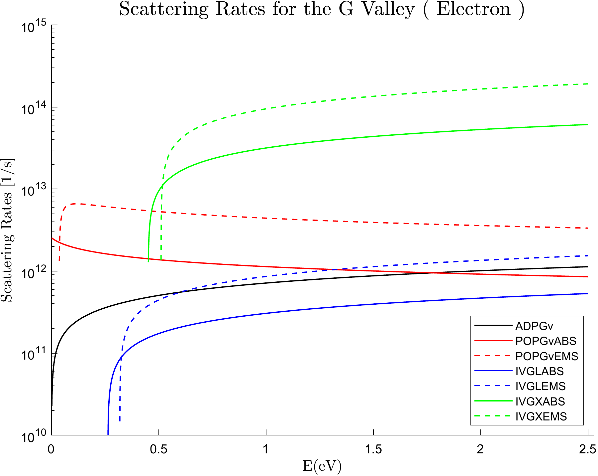
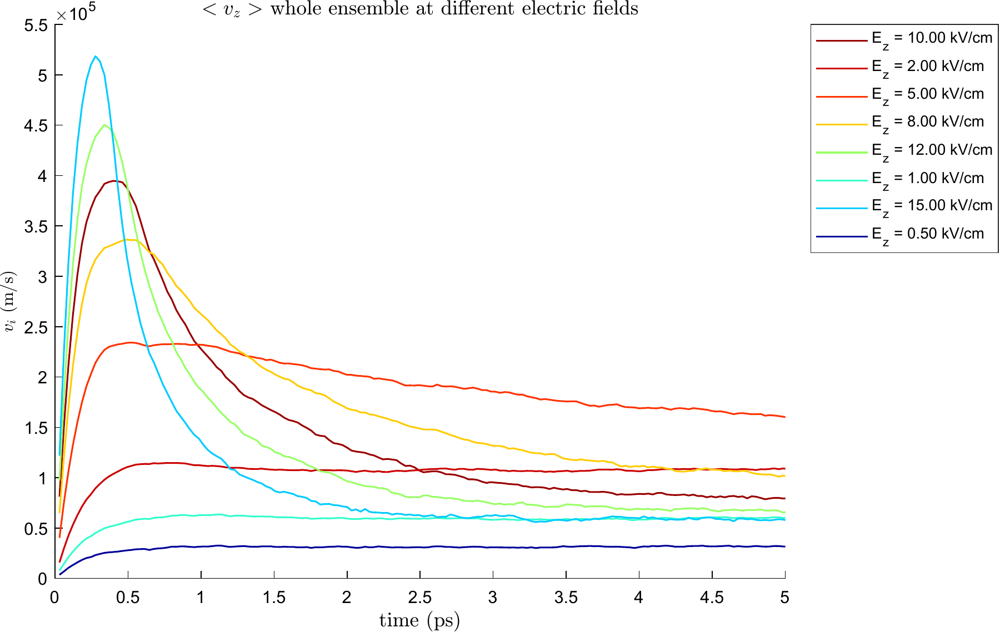
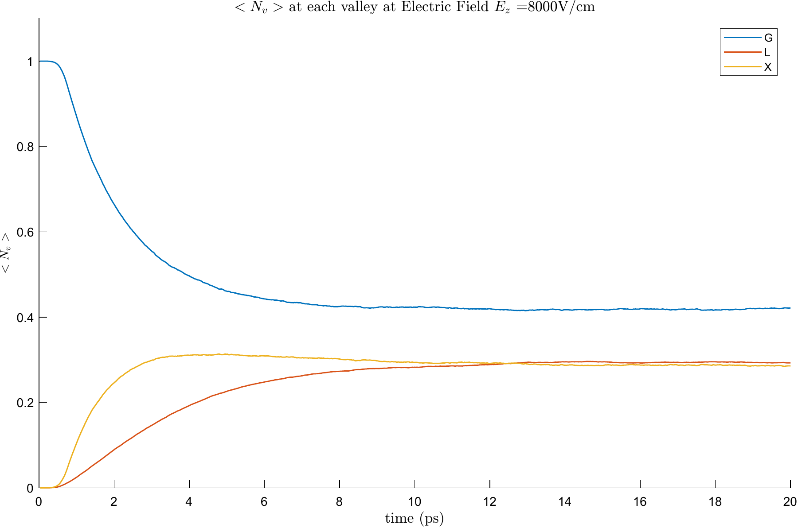
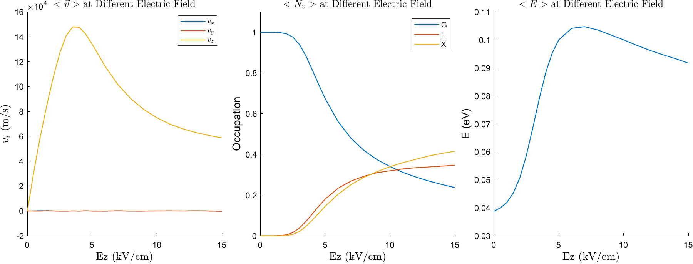

# GaAs Ensemble Monte Carlo

A MATLAB Ensemble Monte Carlo (EMC) simulation of electron transport using GaAs as a material template. The model tracks electric-field-driven motion and phonon scattering across the Γ, L, and X valleys to study transient response, valley transfer, and steady-state transport.

## Four Main Questions

| Topic | Quantities studied | Figure directory |
| --- | --- | --- |
| Initialization and scattering rates | Initial energy and wave-vector (`k_z`) histograms; scattering rates and normalized cumulative rates `W_n` for each valley | [figures_saved_for_problem1](figures_saved_for_problem1/) |
| Transient velocity and energy | Time evolution of mean velocity and kinetic energy for each valley and the full ensemble at different fields | [figures_saved_for_problem3](figures_saved_for_problem3/) |
| Valley occupation | Electron populations in Γ, L, and X as functions of time and electric field | [figures_saved_for_problem3_occupation](figures_saved_for_problem3_occupation/) |
| Steady-state transport | Mean velocity, kinetic energy, and valley occupation versus field; mobility from a linear fit | [figures_saved_for_problem4](figures_saved_for_problem4/) |

These topics follow the four existing figure directories. Directory names do not map directly to the report's problem numbers; the transient analyses share the `problem3` data.

## Selected Results

Representative figures from the project report. Click each image to open the original PDF.

**Scattering rates.** Energy-dependent ADP, POP, and intervalley scattering rates for electrons in the Γ valley.

**Transient drift velocity.** Ensemble drift-velocity magnitude at selected fields from 0.5 to 15 kV/cm, showing pronounced velocity overshoot at higher fields.

**Valley transfer.** At 8 kV/cm, electrons redistribute from the initially occupied Γ valley into L and X as the ensemble approaches steady state.

**Steady-state transport.** Drift velocity, valley occupation, and mean kinetic energy versus electric field. The velocity peaks and then decreases as the satellite-valley populations increase.

## Model and Method

- Isotropic, parabolic bands with effective masses of `0.063`, `0.170`, and `0.58 m₀` for Γ, L, and X. The L and X minima lie `0.29` and `0.48 eV` above Γ.
- Acoustic deformation-potential (ADP) scattering, polar optical phonon (POP) absorption/emission, and intervalley phonon scattering, including equivalent L–L and X–X transitions. ADP and intervalley scattering use isotropic angular sampling; POP uses anisotropic sampling.
- An electric field along z drives free flight between randomly sampled scattering events. Cumulative scattering probabilities and self-scattering select events; velocity, kinetic energy, and valley index are recorded at fixed time intervals.
- Default temperatures are `TE = TL = 300 K`. All electrons start in Γ with isotropic directions and exponentially sampled energies of mean `3kBT/2`.
- The main simulation uses `100000` particles and `1000` time samples, parallelized with `parfor`. Each particle has a fixed seed, `rng(pIndex, 'twister')`.

Kinetic energy is measured from the current valley minimum. Electric field units are V/nm internally, V/cm in filenames, and kV/cm in summary plots; time plots use ps. The simulation duration is `numINTR * timeUnit`.

## Code Structure

| File | Purpose |
| --- | --- |
| `GaAs_GValley_CLS.m`, `GaAs_LValley_CLS.m`, `GaAs_XValley_CLS.m` | Valley parameters, scattering rates, initialization, drift updates, and scattering sampling |
| `test_Nparticle_3valley_part1.m` | Field, temperature, energy grid, and three-valley model setup |
| `test_Nparticle_3valley_part5.m` | Ensemble MC loop and time sampling |
| `post_processing.m` | Valley and ensemble averages; PDF figures and MAT output for one field |
| `script_batch_run_processing.m` | Field sweep that runs the three scripts above in sequence |
| `script_problem01_scattering_rates.m`, `script_problem01_histogram.m` | Scattering-rate and initial-distribution analysis |
| `post_processing_*_time_evolution.m` | Transient velocity, energy, and occupation plots |
| `post_processing_steady_state.m` | Steady-state field dependence and mobility fitting |
| `test_POP.m`, `debug_1particle_3valley_part5.m` | Scattering-angle checks and single-particle debugging |

`initialize_one_particle.m` provides a standalone initialization function. The legacy `script_multi_runs.m` references a missing `part4`; use `script_batch_run_processing.m` instead. `saved_old/` contains earlier code, data, and figures.
